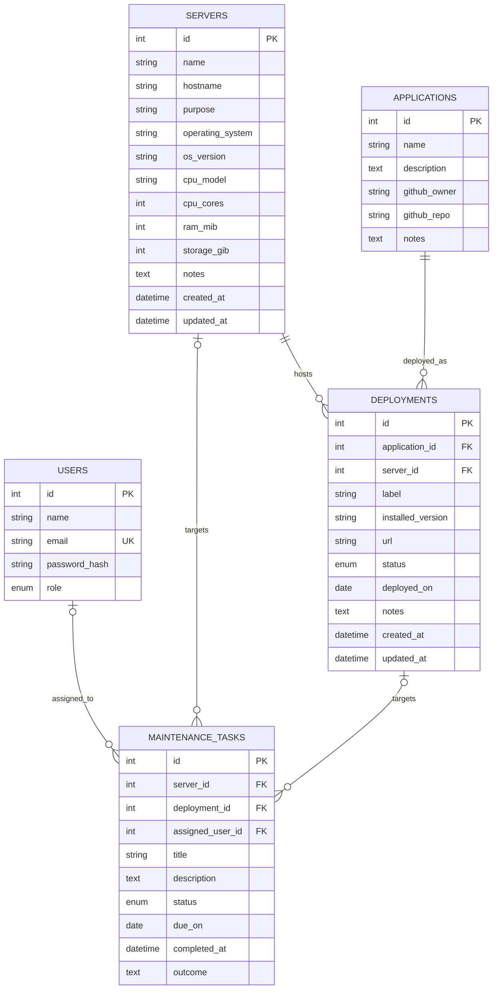

# Entity model — M2

Implemented by [database/homelab-ledger.sql](../database/homelab-ledger.sql).

- All five entities have admin CRUD in the planned API and M1 mock UI.
- Exactly one task target is required: server_id XOR deployment_id. The ERD's
  optional target edges express each column's nullability, not a targetless task.
- Each deployment has one application and server. Multiple instances on the same
  server are allowed; a label identifies the instance. The SQL unique key is
  (application_id, server_id, label), reflected in M1 service validation.
- Emails are unique. Roles: admin, user. Deployment statuses are manually recorded
  running, stopped, or planned, never measured health. Task states: open,
  in_progress, completed. Completed tasks include completion time and outcome.
- Applications optionally link to a GitHub owner/repository pair. GitHub release
  data is external/cache data, not a sixth CRUD entity.
- Foreign keys restrict deletion of servers/applications with deployments and
  server/deployment targets with task history. Deleting a user sets task
  assignments to NULL. Protecting the last admin and active account is a future
  service rule; the DAO has no actor/authentication context.
- Enforced MySQL CHECK constraints require exactly one task target, a nonblank
  outcome and completion time for completed tasks, an installed version for
  non-planned deployments, and both GitHub fields or neither. Non-completed tasks
  have a NULL completion time. Services must also validate these rules in M3/M4.
- No dedicated deployment history table in the first version. Completed tasks
  retain maintenance outcomes; current version updates are not an audit trail.
- Server specifications are optional, manually recorded inventory. NULL means
  unknown; values are not measured CPU, memory or storage utilization. Server and
  deployment record timestamps describe database edits, not deployment events.

## Persistence details

- All IDs and foreign keys are unsigned integers. Each table has an auto-increment
  primary key. Foreign keys use InnoDB; no inventory/history records cascade-delete.
- Names are at most 80 characters, hostnames 253, purposes 200, emails 254,
  application descriptions 500, GitHub identifiers 100, deployment labels 80,
  versions 100, URLs 2048 and task titles 160. Notes, task descriptions and outcomes
  use TEXT with a 5,000-character CHECK limit. Required text must contain a character
  other than ICU Unicode whitespace or U+FEFF (the BOM stripped by JavaScript trim).
  REGEXP_LIKE checks enforce this for all required text, including password_hash,
  a supplied GitHub pair, non-planned installed versions and completed-task outcomes.
  Valid text is stored unchanged; surrounding whitespace is not silently removed.
- An omitted GitHub pair requires two zero-length strings, checked with CHAR_LENGTH.
  Collation equality with an empty string is insufficient because U+FEFF-only values
  compare equal to empty under the configured collation. A supplied pair must pass
  both nonblank predicates, including when both fields contain whitespace.
- Email and deployment-instance uniqueness are case-insensitive and accent-sensitive
  through utf8mb4_0900_as_ci. Services will normalize/trim input before DAO calls.
- Existing optional notes, outcomes, URLs, versions and repository fields default
  to an empty string. Optional dates, task targets and assignees use SQL NULL. completed_at is a UTC DATETIME; PDO sessions use UTC.
- Server operating_system and os_version allow 100 characters; cpu_model allows
  160. These optional text fields default to NULL and reject empty/whitespace-only
  strings when supplied, using the same Unicode checks as required text. Clearing
  a specification uses NULL; valid text, including surrounding whitespace, is preserved.
- cpu_cores is a nullable SMALLINT UNSIGNED (1–65,535). ram_mib and storage_gib
  are nullable INT UNSIGNED values (1–4,294,967,295), recording whole MiB and GiB
  respectively: 32 GiB of RAM is 32,768 MiB. Zero is not a substitute for unknown.
  Numeric format validation before MySQL coercion belongs to the M3 services.
- Servers and deployments have created_at and updated_at as UTC DATETIME(6).
  MySQL CURRENT_TIMESTAMP(6) defaults populate both on insertion; ON UPDATE changes
  updated_at only when stored values change. No-op updates preserve both times.
  DAOs return these fields but exclude them from writable columns. Direct SQL
  import can supply fixed synthetic sample times. UTC relies on the connection's
  session timezone, established by Database::connect(); these are not audit records.
- Secondary indexes support server deployment lookup, task targets and assigned
  user/status/due-date lookup. The deployment unique key also indexes application_id.
- `users.role` defaults to `user`. Sample passwords are PHP password_hash() output;
  no infrastructure credentials or GitHub release cache is stored in these tables.
- The frontend calls tasks `maintenance`; the database table is `maintenance_tasks`.
  The M4 service adapter will map names, empty dates to NULL and completion dates
  between JavaScript ISO strings and UTC SQL DATETIME values. It must also map
  cleared optional specification inputs to NULL and retain the documented units.
- URL scheme/credentials, hostname syntax, email syntax, GitHub identifier syntax,
  password policies, permission checks and API response redaction are service-layer
  validation in M3/M4. Direct DAO access is not an authorization boundary.
