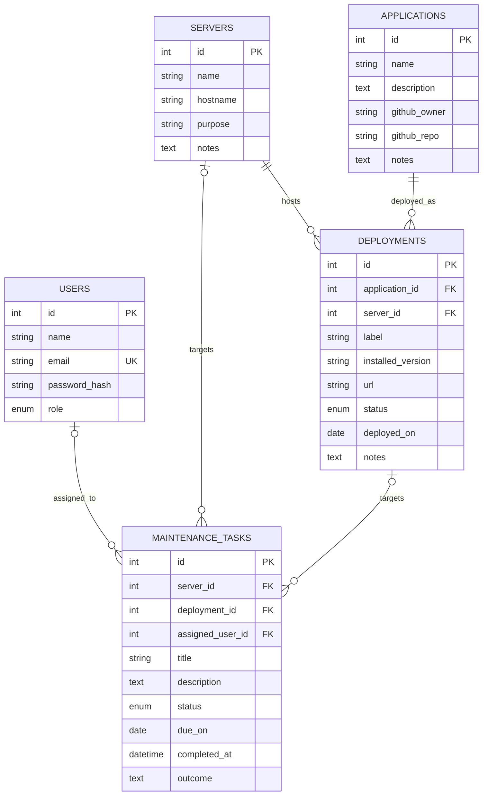

# Draft entity model — M1

- All five entities have admin CRUD in the planned API and M1 mock UI.
- Exactly one task target is required: server_id XOR deployment_id. The ERD's
  optional target edges express each column's nullability, not a targetless task.
- Each deployment has one application and server. Multiple instances on the same
  server are allowed; a label identifies the instance. The planned unique key is
  (application_id, server_id, label), reflected in M1 service validation.
- Emails are unique. Roles: admin, user. Deployment statuses are manually recorded
  running, stopped, or planned, never measured health. Task states: open,
  in_progress, completed. Completed tasks include completion time and outcome.
- Applications optionally link to a GitHub owner/repository pair. GitHub release
  data is external/cache data, not a sixth CRUD entity.
- Restrict deletion of servers/applications with deployments and server/deployment
  targets with task history. Unassign tasks when an otherwise deletable user is
  removed. Protect the last admin and the active account from deletion.
- SQL schema, keys and constraints are implemented in M2. Services enforce rules
  in M3/M4, including target XOR and authorization. SQL checks depend on actual
  hosted MySQL version; use service validation regardless.
- No dedicated deployment history table in the first version. Completed tasks
  retain maintenance outcomes; current version updates are not an audit trail.
